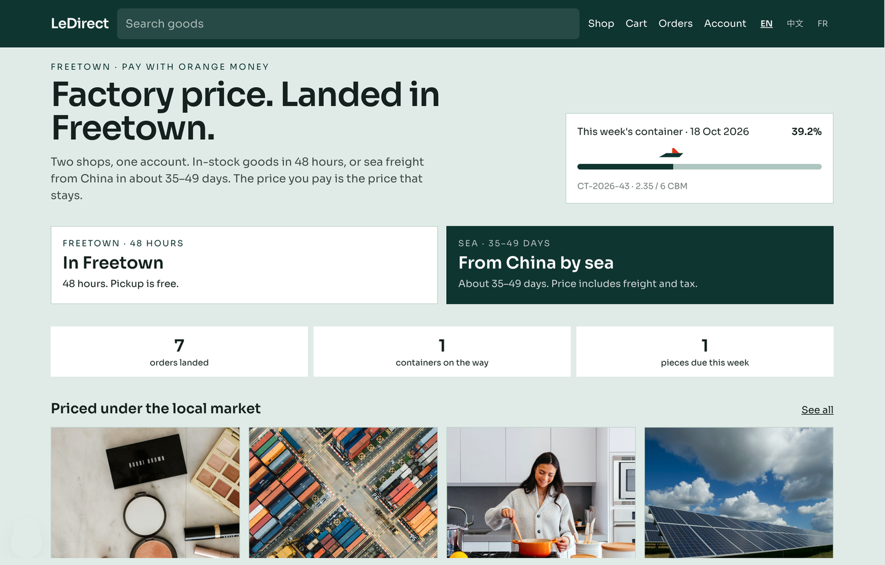

# LeDirect

[English](README.md) · **中文** · [Français](README.fr.md)

作者：Alex Hs

**跨境**商城，带 **直付**、**结算**、**直采** 和 **运输**。

LeDirect 是一套开源的跨境商城，以及后面那张运营台。买家用当地货币支付到手价。这笔钱是直付：款到账，价格和汇率就锁定。结算把每一笔收款、退款和余款对到订单上。直采在货源地买货。运输把货从货源仓，经海运或空运、清关，交到本地仓。

塞拉利昂是本仓库里的参考走廊。价格用利昂。一座仓在中国，一座仓在弗里敦。收银台是移动支付。换一条走廊时，改货币、汇率、支付适配器和两座仓的名字。订单机器不动。



英文是原文。本文件是译文。

## 跨境

跨境订单指钱留在买家所在国，货从另一个国家发出。

两条货道共用一个账户、一个购物车、一次付款：

- **代购。** 付款之后平台才去买，货进入货源仓，再运进来。
- **现货。** 货已经在本地仓。库存不够不能下单。

购物车把两条货道分开，各自标时效。一次结算可以生成两张订单，仍然只付一次。

## 直付

直付指买家用当地货币把钱付给这家店。付成的订单就是合同。

- 标价是到手价：采购、货源地操作、国际运费、关税、税费、目的地操作。结算页拆成三行：商品、国际运费及税费、本地派送。
- 海运按体积。空运按计费重。改空运补的是差额，按该订单现算。
- 现货是一口价，另加本地派送。代购对买家报的是到手价，账单上再把运费拆开。
- 付款成功时，价格和汇率写进订单。之后汇率变动，不改已支付的订单。未支付的购物车用新汇率。
- 汇率缓冲记在平台账上，也出现在汇兑报表里，不加到标价上。种子数据是 3%。汇率由财务录入，另一个人确认后生效。以后可以用汇率源代替手工录入。
- 商店不保存卡号和钱包密码。收银台在支付适配器里。支付结果以服务端回调为准。买家跳回来的页面只负责展示。
- 参考走廊的适配器是 [Monime](https://monime.io)：Orange Money、AfriMoney、银行卡、银行转账、USSD。在设置 `MONIME_SECRET` 之前，演示收银台走同一套回调、幂等和对账。
- 超过钱包单笔上限时，直付自动拆开。定金锁定订单和价格。余款走银行转账。财务确认到账后，直采才开始。种子数据里上限是 13,500 利昂，定金 30%，72 小时未付清余款则订单取消、定金全退。这些都是设置项。

## 结算

结算是支付适配器和订单之间的那本账。

- 回调要验签，并且幂等。
- 每天用订单付款去对支付机构的结算文件。差额生成财务工单。
- 同一订单付成功两次，多出的部分退回。
- 回调没到时，财务可以按机构流水号补单。
- 退多少，看运输走到哪一步。参考规则：采购前取消，全额退；已采购、装柜前取消，退 90%；平台缺货、验货失败，或涨价后买家不接受，全额退；丢件，或超出承诺时效 30 天以上，全额退或免费重发；到货 7 天内的质量问题，附开箱照片，退该商品或补发；余款未按时付清，定金全额退。
- 汇兑损益在财务报表里单独一行。
- 大额退款要第二个人复核。改价、退款、改汇率写入审计日志，记下人、时间、旧值和新值。

## 直采

直采管两件事：一件货怎样上到代购区，一笔已付款怎样在货源地买下来。

代购 SKU 要过五关才上架：

1. 实测重量和外箱尺寸。
2. 英文标题、英文说明，图片至少三张。
3. 当地市场同款价，带来源和日期，用来和街边店比较到手价。
4. HS 编码、关税档，以及归类签字人。
5. 禁售清单通过。种子数据里，35% 关税档先不上。

没有实测数据，仍然可以报价，但不能放在代购货架上。买家贴上来源链接、数量和备注。工作人员在 4 个工作小时内回价。报价有效 24 小时。付款之后并入同一条代购流程。

直付完成之后，采购按下单去买，并把采购记录附在订单上。货源仓随后补上重量和照片。高价商品可以再附开箱视频。

## 运输

运输是两座仓，以及两座仓之间的那段路。

**货源仓** 接收直采来的货，称重、拍照、拼柜。参考走廊里，这座仓在中国。对目的国的买家，它在海外。

**本地仓** 放现货，也接收清关之后的柜子，然后发提货码，或做市内派送。参考走廊里，这座仓在弗里敦。对从货源国操作的团队来说，这座本地仓就是设在市场国的海外仓。

海运按立方米计费。种子数据里，一周的目标柜量是 6 立方米。当周货量不够就顺延。空运按计费重，取实重和 `长 × 宽 × 高 / 6000` 里较大的一个。买家可以把已支付的代购单改成空运，补差额。

代购状态顺序：

`PENDING_PAYMENT` → `PAID`（价格已锁定）→ `PROCURING` → `PROCURED` → `IN_CN_WH` → `CONSOLIDATED` → `SHIPPED`（提单号）→ `ARRIVED` → `CLEARING`（清关）→ `IN_SL_WH` → `READY` → `COMPLETED`

定金单在余款确认前停在 `DEPOSIT_HELD`。现货更短：已支付、拣货、可提货或派送、已送达。规则允许时，`CANCELLED` 与主流程并行。

采购超过 72 小时、货在货源仓超过 5 天、海运超过 49 天、本地待提货超过 7 天，后台会开预警。

付款、已采购、入货源仓、开船、到港、待提货，这些节点会发通知。参考通道是 WhatsApp。提货码和支付异常走短信。对应的密钥配上之前，消息先记在站内收件箱。

## 参考走廊

| | 塞拉利昂种子数据 |
| --- | --- |
| 货币 | 利昂（SLE），整数价格 |
| 直付 | Monime：Orange Money、AfriMoney、卡、银行、USSD |
| 结算 | 回调、每日结算文件对账、按运输阶段退款、账上 3% 汇率缓冲 |
| 直采 | 中国采购台、贴链接报价、上架五关 |
| 运输 | 中国货源仓、按周拼柜、弗里敦本地仓、自提或市内派送 |
| 语言 | 英文、中文、法文 |
| 人员 | 买家用手机号。员工席位：管理员、运营、采购、仓库、客服、财务 |

侨民代付（`Shop for family`）用美元标价、国际卡付款，然后按同一套运输状态送给当地收件人。商家入驻、钱包、以图搜图、货源目录和直播间都有入口，数据会落库。在 `lib/channels.ts` 里配上对应密钥之前，它们用样本数据。

## 本仓库

Next.js 15、React 19、TypeScript、Tailwind。数据库是 `data/ledirect.sqlite`。

| 路径 | 负责什么 |
| --- | --- |
| `lib/pricing.ts` | 整数金额、到手成本、海运和空运 |
| `lib/states.ts` | 跨境状态流和退款阶段 |
| `lib/commerce.ts` | 购物车、直付、结算、直采、拼柜、退款 |
| `lib/channels.ts` | 支付、WhatsApp、短信、商品目录、以图搜图，以及其他外部通道 |
| `scripts/uat.ts` | 验收走查 |
| `scripts/backup.ts` | 备份在 `data/backups`，保留 30 天 |

种子数据打开了演示模式。在设置里关掉演示模式之前，站点不让搜索引擎收录。关掉之后，填了 GA4 编号（`G-` 开头）或 Meta pixel 编号，对应统计代码才会加载。把备份盖回 `data/ledirect.sqlite` 和 `data/uploads` 之前，先停掉应用。

品牌名是暂用名。

## 运行

```bash
npm install
npm run dev
```

打开 http://localhost:3000 ，从 `/demo` 走完整条路径。

顾客：`+232 76 111 001`（Aminata Bangura）。登录验证码显示在页面上。

员工：`ada@ledirect.demo`，密码 `Demo#2026`，然后再输入员工页上的第二组验证码。同一密码适用于 `ledirect.demo` 上的 `ibrahim@`、`wei@`、`mamusu@`、`fanta@`、`joseph@`、`amadu@`。

```bash
npm run uat
npm run backup
```

## 版本

上面的章节是第一次公开的原文。后来的迭代写在旁边，不替换这些章节。

- [更新日志](CHANGELOG.zh-CN.md) · [English](CHANGELOG.md) · [Français](CHANGELOG.fr.md)
- v0.1.0：[docs/index.html](docs/index.html)
- v0.2.0：[docs/v0.2.0.html](docs/v0.2.0.html)，中文、英文、法文

## 许可证

[MIT](LICENSE)。版权所有 © 2026 Alex Hs <bigbrogbpwin@gmail.com>。许可证以英文文本为准。该文件里的中文和法文只供阅读。
